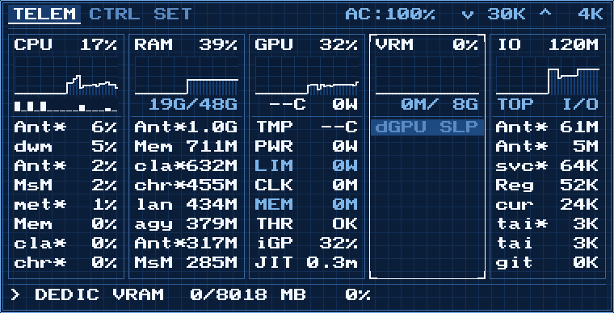
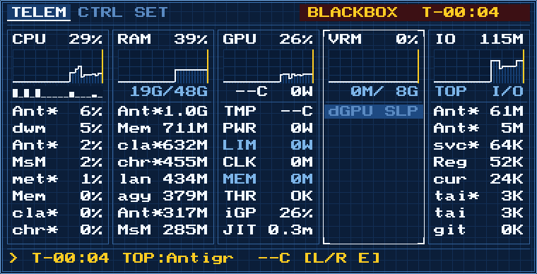
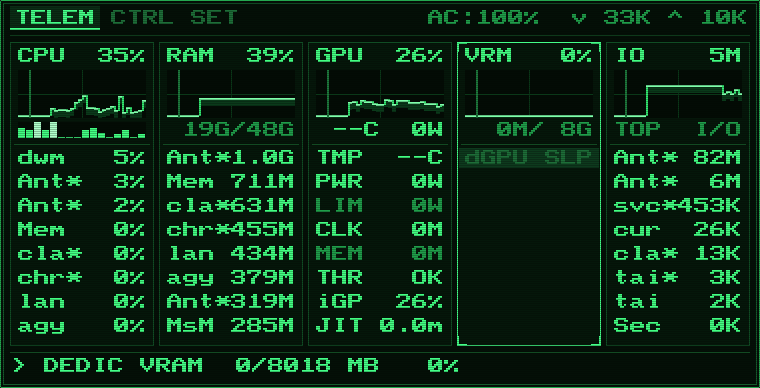
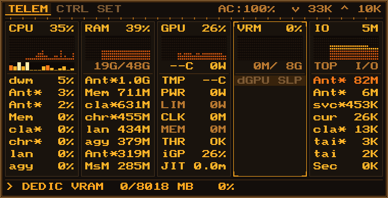
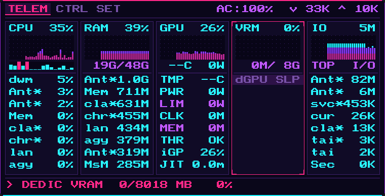
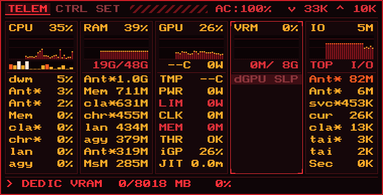

<div align="center">

# ⚡ METALBAR

**A `38.5 KiB` Windows 11 Taskbar Avionics HUD, 5-Minute Black-Box DVR & Per-Process VRAM Radar written in pure hand-crafted x86-64 FASM assembly.**

*Zero CRT · Zero COM · Zero .NET · Zero WMI · Zero PDH · Zero DirectX · Zero Kernel Drivers · Zero Heap (`malloc`) · Strictly 4 Static OS DLLs*

<p>
  
  
  
  
  
</p>



<br />


</div>

---

## One-Line Avionics Install (Windows 11 x64)

### PowerShell
```powershell
irm https://raw.githubusercontent.com/gke0op/metalbar/main/install.ps1 | iex
```

### `curl` (Command Prompt / PowerShell)
```powershell
curl.exe -fsSL https://raw.githubusercontent.com/gke0op/metalbar/main/install.ps1 | powershell -NoProfile -Command "$input | Out-String | iex"
```

```text
+========================================================================+
|  METALBAR // BARE-METAL WINDOWS 11 AVIONICS      [x86-64 FASM | 4 DLL] |
+========================================================================+
|  [1/4] TELEM    Querying github.com/gke0op/metalbar/releases/latest... |
|  [2/4] FETCH    v3.0.1 -> metalbar.exe                                 |
|        [########################################] 39424 B (38.5 KiB)   |
|  [3/4] VERIFY   SHA256:xxxxxxxxxxxx [OK]  PE64:[OK]  ZERO-CRT:[OK]     |
|  [4/4] INSTALL  %LOCALAPPDATA%\MetalBar\metalbar.exe                   |
+------------------------------------------------------------------------+
|  ONLINE  CTRL+SHIFT+SPACE HUD  SPACE BLACKBOX  CTRL+SHF+C THEMES       |
|          F FREEZE  L LOW-GEAR  K KILL  TAB CTRL/SET  CTRL+SHF+Q QUIT   |
+========================================================================+
```

> Or download **`metalbar.exe`** directly from [GitHub Releases](https://github.com/gke0op/metalbar/releases/latest) — single portable executable, no installer wizard, no admin rights required.

---

## Why MetalBar?

Modern Windows hardware monitors ship 150–400 MB Electron/WebView2/.NET runtimes, burn 200+ MB of RAM, spawn dozens of threads, break on non-English Windows locales via localized PDH counters, and keep laptop dGPUs awake out of `D3cold`.

**MetalBar** talks straight to the Windows kernel and GPU subsystem in **10,200 lines of pure x86-64 assembly** with an embedded **768-byte 8×8 bitmap font** and SSE2-accelerated software rasterizer:

* **Per-Process Dedicated VRAM Radar (`VRM` Column):** Uses `D3DKMTQueryStatistics(TYPE_PROCESS_SEGMENT_GROUP = 9, Local = 0)` — zero admin, zero drivers, works for **both CUDA/PyTorch/llama.cpp AND DirectX 12 / Vulkan / DWM** apps (even where NVML returns `NOT_AVAILABLE` on Windows WDDM). Spot who is hoarding your VRAM and kill/freeze them straight from the column.
* **5-Minute Avionics Black-Box Flight Data Recorder (`Space`):** A zero-disk **`9.4 KiB`** static `.bss` ring buffer continuously records 300 seconds of `(CPU, RAM, GPU, VRAM, Temp, Power, Clock, Throttle, I/O, Top-1 CPU app)` even while the HUD is closed. Hit **`Space`** inside the HUD to freeze time, scrub backwards across all 5 oscilloscopes with **`Left`/`Right`** or mouse wheel, and tap **`E`** to snap straight to the last thermal throttle or VRAM spill.
* **Direct Cockpit Process Control (`F` / `L` / `K`):**
  * **`F` — Freeze / Thaw:** Calls `ntdll!NtSuspendProcess` / `NtResumeProcess` to freeze a runaway compile/script (or an entire grouped `[xN]` app swarm!) at **0% CPU** with an ice-cyan `F` indicator, then resumes it without losing state.
  * **`L` — Low-Gear:** Toggles `IDLE_PRIORITY_CLASS` (`L` marker) so loud background jobs stay out of your foreground 165 Hz desktop.
  * **`K` / `Del` — Hardened Quick-Kill:** Protected by self-PID blocking, a 13-process critical OS/shell denylist (`csrss`, `lsass`, `dwm`, `explorer`, etc.), and fresh-snapshot **64-bit UTF-16LE FNV-1a full-name hash** verification (zero PID-reuse TOCTOU races).
* **Native Monitor VSync + Sub-ms Jitter Radar:** Auto-detects your monitor's refresh rate via `EnumDisplaySettingsA` (60 / 144 / 165 / 240 / 360 Hz), pairs `dwmapi!DwmFlush` with dirty-frame skipping + RDTSC-backed `QueryPerformanceCounter` to measure live compositor frame-pacing jitter (`JIT 0.3m`), and drops back to zero-CPU blocking `GetMessageA` the instant you close the HUD.
* **Laptop `D3cold` Sleep Guard + Master Caution:** Lazily loads `nvml.dll` only when the dGPU is actually active (`g_vram_committed > 0`) so sleeping Optimus dGPUs are never woken at boot. Quiet, zero-blink Master Caution flags (`!TMP`, `!VRM`, `!RAM`) appear on the taskbar strip only when a real hardware fault trips.

---

## Black-Box Time-Travel & Live `[SET]` Control Panel

| 5-Minute Black-Box Rewind (`Space` → `Left`/`Right` / `E`) | Live Persistent Settings (`[SET]` Tab, 15 Options) |
| :---: | :---: |
|  |  |

---

## 6 Signature Demoscene Themes (`Ctrl+Shift+C`)

Each theme implements its own border geometry, scope well grid, waveform renderer, post-processing, and taskbar ghost-bar tint:

| `0` Obsidian Heat | `1` Phosphor CRT *(SSE2 scanlines + vector trace)* |
| :---: | :---: |
|  |  |

| `2` Molten Forge *(9-segment LED VU-meter)* | `3` Synthgrid *(45° bevels + dot matrix + gradient)* |
| :---: | :---: |
|  |  |

| `4` Blueprint CAD *(millimeter grid + stepped wireframe)* | `5` NERV Crimson *(diagonal `///` hazard stripes)* |
| :---: | :---: |
|  |  |

---

## Cockpit Controls

### Global Hotkeys (Work Anywhere)
| Shortcut | Action |
|---|---|
| **`Ctrl + Shift + Space`** | Toggle Oscilloscope HUD open / closed |
| **`Ctrl + Shift + C`** | Cycle through all 6 visual themes |
| **`Ctrl + Shift + B`** | Toggle Taskbar Ghost vs. Dark Strip backdrop |
| **`Ctrl + Shift + S`** | Toggle 2× Chunky Retro vs. 1× Micro Pixel scale |
| **`Ctrl + Shift + A`** | Cycle dock anchor (`Bottom-Left` / `Bottom-Right` / `Top-Left` / `Top-Right`) |
| **`Ctrl + Shift + Left / Right`** | Nudge taskbar bar horizontally (`±32 px`) |
| **`Ctrl + Shift + H`** | Hide / show MetalBar |
| **`Ctrl + Shift + Q`** | Cleanly exit MetalBar |

### Inside the HUD
| Key / Mouse | Action |
|---|---|
| **`Tab` / `1` / `2` / `3`** or Click Tabs | Switch between `[TELEM]`, `[CTRL]`, and `[SET]` |
| **`Arrows`** / **Click Row** / **Mouse Wheel** | Navigate columns, scroll top-24 processes, edit settings |
| **`Space`** *(or click top-right status)* | Enter / exit **5-Minute Black-Box Rewind Mode** |
| **`Left` / `Right`** / **`PgUp` / `PgDn`** / **Wheel** *(in Black-Box)* | Scrub 1s / 15s / 3s backward & forward in time |
| **`E`** | Auto-freeze & jump straight to the last hardware anomaly (`!TMP`/`!VRM`/`!PWR`/`!RAM`) |
| **`F`** | **Freeze / Thaw** selected process (or grouped `*` app swarm) at 0% CPU |
| **`L`** | Toggle **Low-Gear (`IDLE`)** background priority |
| **`K` / `Delete`** → **`Y` / `N`** | Hardened Quick-Kill (works in `CPU`, `RAM`, `VRM`, and `IO`!) |
| **`Esc` / `Alt + F4`** | Cleanly hide HUD & restore focus to previous window |

---

## Bare-Metal Architecture Scorecard

| Section / Metric | MetalBar v3.0.1 | Notes |
|---|---:|---|
| **PE64 Disk Size** | **`39,424 B` (`38.50 KiB`)** | Single-pass `FASM 1.73.35` output |
| **`.text` (All Machine Code)** | **`30,317 B` (`29.61 KiB`)** | Telemetry + 6-theme rasterizer + VSync + Black-Box + UI |
| **`.rdata` (Font + Tables + UI)** | **`4,376 B` (`4.27 KiB`)** | Includes 768 B embedded 8×8 monochrome ASCII font |
| **`.data` (Defaults)** | **`140 B`** | Persisted in 64-byte `metalbar.cfg` beside exe |
| **`.bss` (Static Zero-Heap)** | **`1.64 MiB`** *(0 B on disk)* | 1.5 MiB NT proc buffer, 1024-proc table, 300-frame Black-Box |
| **Static PE64 Imports (`.idata`)** | **Strictly 4 OS DLLs** | `NTDLL.DLL`, `KERNEL32.DLL`, `USER32.DLL`, `GDI32.DLL` |
| **Dynamic Optional Loaders** | `LoadLibraryA` at runtime | `nvml.dll` (lazy D3cold-safe), `dwmapi.dll`, `powrprof.dll`, `iphlpapi.dll`, `advapi32.dll` |
| **Locale Dependence** | **Zero** | Direct NT classes `0/2/5/8` & `D3DKMT` — works on any Windows language |
| **Idle CPU (HUD Closed)** | **`~0.00–0.03%`** | Blocking `GetMessageA`, zero polling of processes/NIC/battery when closed |

### Source Layout
```text
src/
├── metalbar.asm     Win32 dual-window host, Z-order hook, DwmFlush VSync + QPC jitter, config v5
├── hud_raster.inc   6-theme oscilloscope engine, Black-Box overlay, SSE2 CRT scanlines, 3 tabs
├── telemetry.inc    NT syscalls 0/2/5/8, D3DKMT Type 9 per-proc VRAM, lazy NVML, Black-Box, Freeze/Kill
├── raster.inc       Always-on taskbar strip rasterizer, branchless color tables, Master Caution
├── metal_defs.inc   Live-verified Win11 x64 (Build 26200) struct offsets & constants
└── font8x8.inc      768-byte embedded 8x8 ASCII bitmap font (slashed zeroes)
```

---

## Build From Source (0.2 Seconds)

Requires only [flat assembler (FASM 1.73.35)](https://flatassembler.net/) — no Visual Studio, no Windows SDK, no CMake, no Rust/Go toolchain:

```powershell
git clone https://github.com/gke0op/metalbar.git
cd metalbar

# Auto-downloads official FASM 1.73.35 to tools\fasm\ and assembles bin\metalbar.exe:
.\build.ps1 -FetchFasm

# Run it!
.\bin\metalbar.exe
```

Subsequent rebuilds take ~0.2 seconds with `.\build.ps1`.

---

## License

[MIT](LICENSE) © 2026 gke0op
