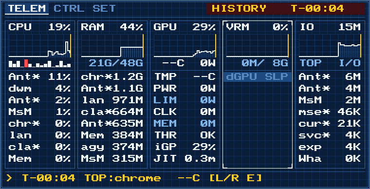
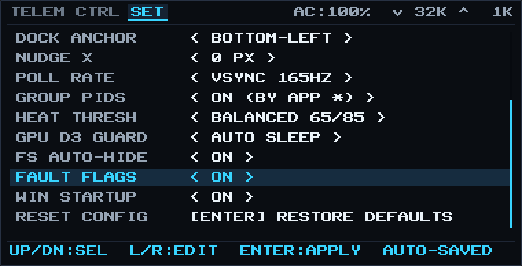
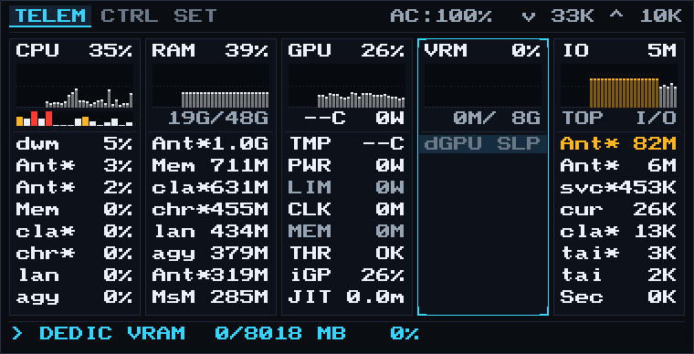
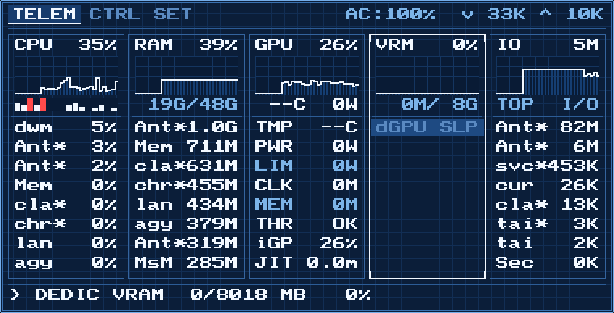

<div align="center">

# METALBAR

**`38.5 KiB` Windows 11 x86-64 taskbar telemetry bar, oscilloscope HUD, per-process VRAM monitor, and 5-minute ring-buffer recorder in pure FASM assembly.**

`Zero CRT` · `Zero COM` · `Zero .NET` · `Zero WMI` · `Zero PDH` · `Zero DirectX` · `Zero Drivers` · `Zero Heap` · `4 Static OS DLLs`

<p>
  
  
  
  
  
</p>


<br />


</div>

---

## Install (Windows 11 x64)

### PowerShell
```powershell
irm https://raw.githubusercontent.com/gke0op/metalbar/main/install.ps1 | iex
```

### `curl` (cmd / PowerShell)
```powershell
curl.exe -fsSL https://raw.githubusercontent.com/gke0op/metalbar/main/install.ps1 | powershell -NoProfile -Command "$input | Out-String | iex"
```

```text
+========================================================================+
|  METALBAR // WINDOWS 11 x86-64 TELEMETRY HUD      [FASM | 4 OS DLLS]   |
+========================================================================+
|  [1/4] QUERY    github.com/gke0op/metalbar/releases/latest             |
|  [2/4] FETCH    v3.0.1 -> metalbar.exe                                 |
|          [########################################] 39424 B (38.5 KiB) |
|  [3/4] VERIFY   SHA256:xxxxxxxxxxxx [OK]  PE64:[OK]  ZERO-CRT:[OK]     |
|  [4/4] INSTALL  %LOCALAPPDATA%\MetalBar\metalbar.exe                   |
+------------------------------------------------------------------------+
|  ONLINE  CTRL+SHIFT+SPACE HUD  SPACE HISTORY  CTRL+SHF+C THEMES        |
|          F SUSPEND  L IDLE  K KILL  TAB CTRL/SET  CTRL+SHF+Q QUIT      |
+========================================================================+
```

Portable binary also available directly under [Releases](https://github.com/gke0op/metalbar/releases/latest). No installer wizard, no admin privileges required.

---

## Technical Overview

MetalBar queries the Windows kernel and WDDM directly in x86-64 assembly with an embedded 768-byte 8×8 monochrome bitmap font and software ARGB rasterizer:

* **System Telemetry (Locale-Independent):** `NtQuerySystemInformation` classes `0` (physical pages), `2` (available RAM, kernel I/O bytes), `5` (up to 1024 processes, private working set, CPU time, per-process I/O, optional name grouping via 64-bit UTF-16LE FNV-1a hash), and `8` (total and per-logical-core CPU%).
* **Per-Process Dedicated VRAM (`VRM` Column):** `D3DKMTQueryStatistics(TYPE_PROCESS_SEGMENT_GROUP = 9, Local = 0)` — 1 call per accessible process, no admin rights, works across CUDA, Direct3D 12, Vulkan, and DWM (bypassing Windows WDDM NVML `NOT_AVAILABLE`).
* **GPU Metrics & `D3cold` Guard:** `D3DKMTQueryStatistics(SEGMENT / NODE)` for dedicated VRAM and iGPU utilization; lazy `LoadLibraryA("nvml.dll")` for NVIDIA utilization, temperature, power, clocks, and throttle flags only while `g_vram_committed > 0`, keeping idle Optimus dGPUs in `D3cold`.
* **5-Minute Ring-Buffer History (`Space`):** `300 × 32 B` (`9.4 KiB`) static `.bss` ring buffer recording 1 Hz frames continuously (zero disk I/O). Pressing `Space` pauses the HUD and scrubs all 5 waveforms backward (`Left`/`Right`, `PgUp`/`PgDn`, mouse wheel); `E` jumps to the previous fault frame (`!TMP`, `!VRM`, `!PWR`, `!RAM`, `!CPU`).
* **Process Controls (`F` / `L` / `K`):**
  * `F`: `ntdll!NtSuspendProcess` / `NtResumeProcess` (toggles suspend/resume on single PID or grouped process set).
  * `L`: `SetPriorityClass` (`IDLE_PRIORITY_CLASS` / `NORMAL_PRIORITY_CLASS`).
  * `K` / `Del` → `Y`: `TerminateProcess`. All three enforce `PID > 4`, self-PID exclusion, a 13-name critical OS denylist (`csrss.exe`, `lsass.exe`, `dwm.exe`, `explorer.exe`, etc.), and fresh-snapshot 64-bit UTF-16LE name-hash verification against PID reuse.
* **Native VSync & Jitter Measurement:** Auto-detects display refresh rate via `EnumDisplaySettingsA`; uses `dwmapi!DwmFlush` with dirty-frame skipping while the HUD is open and `QueryPerformanceCounter` to track compositor/timer jitter (`JIT X.Xm`). Falls back to blocking `GetMessageA` when the HUD is closed (`~0.00–0.03%` CPU).
* **Fault Flags (`FAULT FLAGS`):** Optional non-blinking `!TMP` (`>= 90°C` or thermal throttle), `!VRM` (`>= 95%`), or `!RAM` (`>= 92%`) indicator on the taskbar strip.

---

## Ring-Buffer Rewind & Settings

| 5-Minute History Rewind (`Space` → `Left`/`Right`, `E`) | Live Settings (`[SET]` Tab, 15 Options, `metalbar.cfg`) |
| :---: | :---: |
|  |  |

---

## Themes (`Ctrl+Shift+C`)

| `0` Obsidian Heat | `1` Phosphor CRT *(SSE2 scanlines + vector trace)* |
| :---: | :---: |
|  |  |

| `2` Molten Forge *(9-segment LED bars)* | `3` Synthgrid *(45° bevels + dot grid + 3-band fill)* |
| :---: | :---: |
|  |  |

| `4` Blueprint CAD *(16px grid + stepped trace)* | `5` NERV Crimson *(diagonal header stripes)* |
| :---: | :---: |
|  |  |

---

## Controls

### Global Hotkeys
| Shortcut | Action |
|---|---|
| `Ctrl + Shift + Space` | Toggle HUD |
| `Ctrl + Shift + C` | Cycle theme (0–5) |
| `Ctrl + Shift + B` | Toggle taskbar Ghost / Dark Strip |
| `Ctrl + Shift + S` | Toggle 2× / 1× bar scale |
| `Ctrl + Shift + A` | Cycle dock anchor (BL / BR / TL / TR) |
| `Ctrl + Shift + Left / Right` | Nudge bar ±32 px |
| `Ctrl + Shift + H` | Hide / show bar |
| `Ctrl + Shift + Q` | Exit |

### Inside HUD
| Input | Action |
|---|---|
| `Tab` / `1` / `2` / `3` / Click tab | Switch `[TELEM]` / `[CTRL]` / `[SET]` |
| `Arrows` / Click row / Wheel | Select column, row, or edit setting |
| `Space` / Click top-right | Toggle 5-minute history rewind |
| `Left` / `Right` / `PgUp` / `PgDn` / Wheel *(paused)* | Scrub ±1s / ±15s / ±3s |
| `E` | Pause and jump to previous fault frame |
| `F` | Suspend / resume selected process(es) |
| `L` | Toggle `IDLE` / `NORMAL` priority |
| `K` / `Del` → `Y` / `N` | Terminate selected process(es) |
| `Esc` / `Alt + F4` | Hide HUD and restore previous window focus |

---

## Binary Footprint

| Section | Size | Contents |
|---|---:|---|
| **PE64 on disk** | **`39,424 B` (`38.50 KiB`)** | Single `FASM 1.73.35` output |
| **`.text`** | **`30,277 B`** | Telemetry, rasterizer, Win32 host, VSync loop |
| **`.rdata`** | **`4,376 B`** | 768 B 8×8 font, color tables, UI strings |
| **`.data`** | **`140 B`** | Runtime defaults (overridden by 64 B `metalbar.cfg`) |
| **`.bss`** | **`1.64 MiB`** *(0 B on disk)* | 1.5 MiB `SPI5` buffer, 1024-proc table, 300-frame history |
| **`.idata`** | **4 static DLLs** | `NTDLL.DLL`, `KERNEL32.DLL`, `USER32.DLL`, `GDI32.DLL` |

Optional dynamic loads (`LoadLibraryA`): `nvml.dll`, `dwmapi.dll`, `powrprof.dll`, `iphlpapi.dll`, `advapi32.dll`.

### Source Layout
```text
src/
├── metalbar.asm     Win32 host, Z-order WinEventHook, DwmFlush VSync, QPC jitter, config v5
├── hud_raster.inc   6-theme HUD rasterizer, history overlay, SSE2 CRT scanlines, 3 tabs
├── telemetry.inc    NT classes 0/2/5/8, D3DKMT Type 9 VRAM, lazy NVML, ring buffer, process actions
├── raster.inc       Taskbar bar rasterizer, branchless theme tables, fault flags
├── metal_defs.inc   Win11 x64 (Build 26200) struct offsets and constants
└── font8x8.inc      768-byte 8x8 ASCII bitmap font
```

---

## Build From Source

Requires only [FASM 1.73.35](https://flatassembler.net/) (no Visual Studio, Windows SDK, or CMake):

```powershell
git clone https://github.com/gke0op/metalbar.git
cd metalbar
.\build.ps1 -FetchFasm
.\bin\metalbar.exe
```

---

## License

[MIT](LICENSE) © 2026 gke0op
